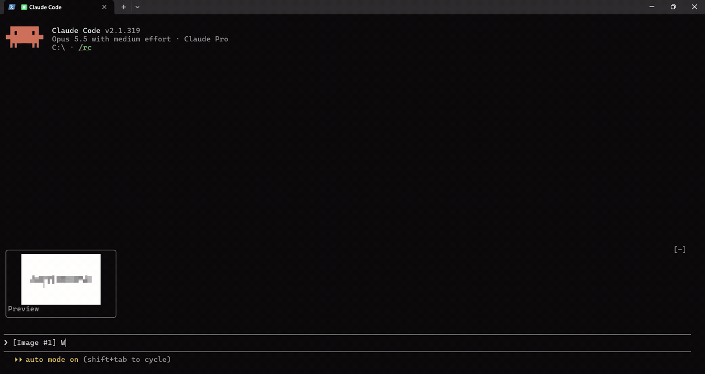

# glance: image previews for Claude Code

Glance is a Claude Code plugin that shows the images you paste into Claude Code as previews in the terminal. Without it, a pasted image is just the words `[Image #1]`. With glance, you see the picture above your prompt before you send it, and under your message after.

> **Requires [Node.js](https://nodejs.org)** (any current LTS version). Glance decodes images with Node. Claude Code doesn't include it, so install it first if `node --version` doesn't work in your terminal. If Node.js is missing, glance tells you once.

| Without glance | With glance |
|---|---|
| ![Claude Code without glance: pasting an image shows only the text [Image #1]](assets/before.gif) |  |
| A pasted image is only an `[Image #1]` tag. | You see the image before you send it, under your message after, and full size in a side pane. |

## What it does

- **Before you send:** paste an image and its preview appears right above the input. Delete the `[Image #1]` placeholder and its preview goes too.
- **After you send:** the previews appear under your message. Old chats get theirs back when you reopen them.
- **Full size:** press **Preview** to open the image in a pane, and **Open original** there for your image viewer. Press `Esc` to close the pane.
- **Saves nothing:** glance reads the images Claude Code already keeps and draws them from memory. It writes no files.
- It runs without a model turn, so it uses no tokens.

## Install

In Claude Code:

```
/plugin marketplace add akbarjorayev/glance
/plugin install glance@glance
```

Then turn on updates, once: run `/plugin`, open **Marketplaces**, select **glance** and choose **Enable auto-update**. Claude Code then fetches new versions in the background and uses them the next time it starts. Without this, Claude Code doesn't update plugins from marketplaces you add yourself, and you'd run `/plugin marketplace update glance` by hand.

## How it looks

Every preview sits in a small frame of the same size, whatever the image's shape: wide screenshots and tall phone shots are fitted inside and centered. Press **Preview** in a frame to open the image full size in a pane. From there, **Open original** shows it in your system's image viewer at full quality.

Glance draws with colored block characters, so it works in any terminal with true color. For each cell it picks the shape (halves, quarters, eighths) and two colors that best match the image. Shapes, layout and colors come through clearly, but small text inside a screenshot can't be read.

## Questions

### Which image types work?

PNG and JPEG, which covers screenshots and photos. Other types show "no preview", and Claude still receives them as usual.

### Do previews come back when I reopen an old chat?

Yes. Glance rebuilds them from the images Claude Code keeps: its temp folder first, then the chat itself. If you ran `/compact` and the temp files were cleaned up since, images from before the compaction can't be shown again.

### Does it use disk space?

No. Glance never writes a file. Claude Code already keeps your pasted images in its temp folder (`%TEMP%\claude` on Windows, `/tmp/claude-<uid>` elsewhere) and in the chat history. Glance reads them from there and keeps the previews in memory for the session.

### Does my image go anywhere?

No. Glance works only on your computer. Nothing is uploaded. The full details are in the [privacy policy](PRIVACY.md).

## What glance runs and reads

So you know exactly what happens on your computer:

- **Network:** none. Glance never connects to anything.
- **What it reads:** the text in your prompt box, about five times a second, to spot `[Image #n]` placeholders; the images Claude Code keeps in its temp folder; and, for old chats, the images in the chat's history.
- **Programs it starts:** Node.js, to run its own script that decodes and draws images. When you press **Open original**, your system's default app for the image (`rundll32` on Windows, `open` on macOS, `xdg-open` on Linux).
- **Files it writes:** none.

## Known limits

- Clicking **Preview** needs Claude Code to receive mouse clicks, which it does in its fullscreen layout.
- **Open original** works for images Claude Code still keeps in its temp folder. For an old chat whose temp files were cleaned up, the pane shows the image without that button, because glance never writes its own copy.
- I test glance on Windows. The macOS and Linux paths were reviewed by reading the code, not run.

## Releasing

Bump `version` in `.claude-plugin/plugin.json` and `package.json` (for example `1.0.0` → `1.0.1`), then push. Claude Code only updates people whose version differs, so a push without a version change reaches nobody.

## Development

```
npm install
npm test                      # image decoding and drawing (scripts/)
claude plugin test .          # the hooks module (hooks/)
claude plugin validate .
claude --plugin-dir .         # run Claude Code with your local copy
```

`hooks/register.tsx` finds images and draws them. `scripts/glance.mjs` decodes and paints them, because hooks modules have no Node. `CLAUDE.md` describes the design.

## License

[MIT](LICENSE) © Akbar Jorayev
